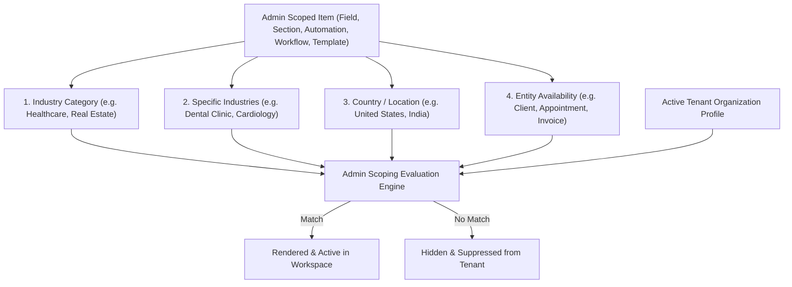

# MantraAssist Admin Scope Architecture & Specification (`ADMIN_SCOPE_SPECIFICATION.md`)

**Version 1.0 — Platform Multi-Tenant Governance & Dynamic Scoping Engine**  
*MantraAssist System Documentation · Product & Engineering Architecture*

---

## 1. Executive Summary: What is Admin Scope?

In a multi-tenant platform serving diverse verticals (Healthcare, Real Estate, Legal, Automotive, IT/MSP, Wellness, etc.) across different international markets (US, UK, India, Canada, UAE, etc.), **not all tenant organizations should see the same fields, workflow stages, document templates, or automation triggers**.

A dental clinic in New York should not see real-estate MLS property fields or Indian GST billing forms. At the same time, maintaining separate codebases or siloed databases for each industry and country is unmaintainable.

**Admin Scope** is MantraAssist's unified multi-tenant governance engine. Configured by Super Admins in the Admin Console, Admin Scope dictates:
1. **Inheritance & Visibility**: Which tenant organizations automatically receive specific custom fields, overview sections, document templates, and workflow pipelines.
2. **Lifecycle Execution**: Which automations and AI receptionist workflows trigger based on an organization's profile and active context.
3. **Data Integrity & Noise Prevention**: Keeping tenant workspaces clean, relevant, and compliant with local industry regulations without requiring manual tenant-by-tenant setup.

---

## 2. Core Scoping Dimensions

Every scoped resource in MantraAssist evaluates against a combination of **4 primary dimensions**:



### 2.1 The Four Dimensions:

| Dimension | Scope Level | Examples in Codebase | Default If Unspecified |
| :--- | :--- | :--- | :--- |
| **1. Industry Category** | Top-level vertical classification | `Healthcare`, `Real Estate`, `Automobile`, `IT/Tech`, `Legal`, `Wellness & Lifestyle` | `"All"` / Global (all categories match) |
| **2. Industries** | Specific domain niches under a category | `Dental Clinic`, `Orthopedics`, `Commercial Brokerage`, `Managed Service Provider (MSP)` | Empty array `[]` / `"All"` (all industries in category) |
| **3. Locations / Countries** | Geographic jurisdiction | `United States`, `United Kingdom`, `India`, `Canada`, `Australia`, `Global` | Empty array `[]` / `"All"` (all countries match) |
| **4. Entity Modules** | Target application entities | `client`, `process`, `appointment`, `call`, `service`, `invoice`, `claim` | All entities enabled |

---

## 3. Scoping Data Model & Logic Rules

### 3.1 Data Interface (`ScopingRule`)
Defined across `FieldRegistryContext.tsx`, `useProcessStore.ts`, and `documentTemplatesStore.ts`:

```typescript
export interface ScopingRule {
  id?: string;
  industryCategory?: string; // e.g. "Healthcare"
  industries?: string[];     // e.g. ["Dental Clinic", "Pediatric Dentistry"]
  locations?: string[];      // e.g. ["United States", "Canada"]
  entities?: string[];       // e.g. ["client", "appointment"] (for templates & fields)
}
```

### 3.2 Boolean Evaluation Matrix
Admin Scoping implements a strict **"AND inside a rule, OR across multiple rules"** boolean model:

$$\text{Item Visible} = \text{Rule}_1 \lor \text{Rule}_2 \lor \dots \lor \text{Rule}_n$$

Where each $\text{Rule}_k$ evaluates as:

$$\text{Rule}_k = \text{CategoryMatch} \land \text{IndustryMatch} \land \text{LocationMatch} \land \text{EntityMatch}$$

- **Intra-Rule (AND)**: Within a single rule, an organization must satisfy *all* non-empty constraints specified in that rule.
- **Inter-Rule (OR)**: If an item has multiple rules, satisfying *any single rule* grants visibility.

---

## 4. How Different Cases Are Handled by Admin Scope

MantraAssist handles tenant provisioning across eight distinct operational scenarios:

---

### Case 1: Universal / Global Scope (Unconstrained)
* **Configuration**: `scopingRules: []` (no rules added) or all dimensions set to `"All"` / `*`.
* **Behavior**:
  - The resource is universally accessible to **every organization** across the entire platform.
  - Used for fundamental platform features: Client Name, Phone, Email, standard NDA contracts, universal appointment booking automations.
* **Evaluation Result**:
  ```typescript
  if (!hasCat && !hasInd && !hasLoc) return true; // Universally visible
  ```

---

### Case 2: Broad Industry Category Scope
* **Configuration**:
  - `industryCategory: "Healthcare"`
  - `industries: []` (or not set)
  - `locations: []` (or not set)
* **Behavior**:
  - Any tenant organization whose category is `"Healthcare"` (e.g. Hospitals, Dental Clinics, Physiotherapy, Telehealth) receives the resource.
  - Any tenant belonging to `"Real Estate"`, `"Automobile"`, or `"Legal"` will **never see** this resource.
  - Country of operation does not restrict access.
* **Example**: A generic "Medical History & Allergies" section or HIPAA/GDPR health notice.

---

### Case 3: Niche Industry-Specific Scope
* **Configuration**:
  - `industryCategory: "Healthcare"`
  - `industries: ["Dental Clinic", "Orthodontics"]`
  - `locations: []`
* **Behavior**:
  - Only dental practices inherit this resource.
  - A cardiology hospital or general wellness studio in the `"Healthcare"` category will **not** see it, preventing clinical clutter.
* **Example**: "Teeth Numbering Chart" field, "Dental Impression Ready" workflow stage, or "Orthodontic Recall" voice receptionist prompt.

---

### Case 4: Geographic / Country-Specific Scope (Regulatory & Tax)
* **Configuration**:
  - `industryCategory: "All"`
  - `industries: []`
  - `locations: ["India"]`
* **Behavior**:
  - Only organizations operating in `"India"` will receive this field or automation.
  - Organizations in the US, UK, or Canada will never see it.
* **Multi-Location Organizations**:
  - If a tenant operates in multiple locations (e.g., `locations: ["United States", "Canada", "India"]`), the evaluation checks for set intersection. If at least one location matches, the rule passes.
* **Example**: "GSTIN / PAN Tax Identification Number", UPI QR payment link automations, or local statutory consent disclosures.

---

### Case 5: Compound Multi-Dimensional Scope (Category + Industry + Location)
* **Configuration**:
  - `industryCategory: "Healthcare"`
  - `industries: ["Medical Clinic", "Hospital"]`
  - `locations: ["United States"]`
* **Behavior**:
  - Strictly requires the tenant to be in `"Healthcare"`, operating as a `"Medical Clinic"` or `"Hospital"`, located in the `"United States"`.
  - A US Dental clinic will fail (industry mismatch).
  - A UK Hospital clinic will fail (location mismatch).
* **Example**: "CMS 1500 Health Insurance Claim Form" and "US NPI Number" validation field.

---

### Case 6: Multi-Rule Hybrid Scope (OR Logic)
* **Scenario**: A document template or automation applies to all Real Estate agencies in the US, **plus** all Legal firms in the UK.
* **Configuration**:
  - **Rule 1**: `Category: Real Estate`, `Location: United States`
  - **Rule 2**: `Category: Legal`, `Location: United Kingdom`
* **Behavior**:
  - Tenant A (US Real Estate): Matches Rule 1 $\rightarrow$ **Visible**.
  - Tenant B (UK Law Firm): Matches Rule 2 $\rightarrow$ **Visible**.
  - Tenant C (UK Real Estate): Fails Rule 1 (Location) and Rule 2 (Category) $\rightarrow$ **Hidden**.

---

### Case 7: Entity & Module Context Scoping
* **Configuration**: `entities: ["client", "appointment"]`
* **Behavior**:
  - Controls *where inside the workspace UI* a scoped resource can be invoked.
  - A document template scoped to `["client", "appointment"]` will appear in the Patient/Client Profile drawer and the Appointment Detail Drawer.
  - It is automatically filtered out from Invoices and Claims tables to avoid inappropriate document assignments.
* **Example**: "Informed Consent & Treatment Agreement" is available when scheduling an appointment, but omitted when generating a billing invoice.

---

### Case 8: Pipeline & Process-Specific Binding (`processIds`)
* **Configuration**: `processIds: ["proc-intake-101"]`
* **Behavior**:
  - Custom fields and workflow triggers can be constrained down to a specific active pipeline.
  - Even if an organization matches the industry and location, the field only appears on clients or deals traversing that designated pipeline.
* **Example**: "Vehicle Trade-in Valuation" field only appears when a deal is in the "Car Trade-In Evaluation" pipeline, hidden during "Routine Oil Change Service".

---

## 5. System Fields vs. Custom Fields Governance

Admin Scope enforces strict immutability boundaries to prevent accidental platform breakage:

| Item Type | Source Flag | Scoping Behavior | Tenant Permissions |
| :--- | :--- | :--- | :--- |
| **System Primitives** | `source: "system"` or `id < 0` | Always match (`isFieldMatchingOrg` returns `true`). Never suppressed. | Fixed schema. Cannot be deleted or renamed by tenants. |
| **Admin Template** | `source: "template"` | Evaluated against `scopingRules`. Automatically provisioned to matching tenants. | Tenants can edit values, customize stage names, or add local actions based on admin permission flags (`canHide`, `canEdit`, `canDelete`). |
| **Tenant Custom** | `source: "custom"` | Scoped locally to the creating tenant organization. | Full CRUD permissions within tenant workspace. |

---

## 6. Where Admin Scope is Used in MantraAssist

| Module | Location | Scoped Resources |
| :--- | :--- | :--- |
| **Custom Fields & Sections** | `/admin/custom-fields` | Form inputs, overview summary cards, repeatable tables, and rating fields. |
| **Process Templates (Workflows)** | `/admin/process-templates` | Multi-stage pipeline templates, default SLA timers, and stage entry actions. |
| **Global Automations** | `/admin/automations` | Move-to-stage event rules, AI voice call triggers, and automated WhatsApp/email notifications. |
| **Document Templates** | `/admin/document-templates` | Fillable contracts, intake questionnaires, consent forms, and invoice layout templates. |
| **Subscription Plans & Pricing** | `/admin/plans` | Tier features and country currency pricing matrices (`CountryPricing`). |

---

## 7. Developer Cheat Sheet: Scoping Function Reference

When building or updating features, use the standard scoping helpers from `FieldRegistryContext.tsx` and `useProcessStore.ts`:

```typescript
// 1. Check if a custom field matches active tenant organization
import { isFieldMatchingOrg } from "../context/FieldRegistryContext";
const visibleFields = allFields.filter(f => isFieldMatchingOrg(f, activeOrganization));

// 2. Check if a field matches a specific pipeline
const processFields = allFields.filter(f => isFieldMatchingOrg(f, activeOrganization, activeProcessId));

// 3. Check if a workflow / process matches active tenant organization
import { isProcessMatchingOrg } from "../../lib/useProcessStore";
const visibleProcesses = allProcesses.filter(p => isProcessMatchingOrg(p, activeOrganization));

// 4. Check if a document template matches active tenant organization
import { isTemplateMatchingOrg } from "../../lib/documentTemplatesStore";
const availableTemplates = templates.filter(t => isTemplateMatchingOrg(t, activeOrganization));
```

---

## 8. Summary Checklist for Admins

1. **Keep Default Scope Empty for Universal Items**: If an item should be visible to all customers worldwide, do not add any rules.
2. **Use Multi-Select for Category Bundles**: If a template applies to both "Dental" and "Dermatology", select both under the "Healthcare" category.
3. **Use Countries Only When Legally Necessary**: Avoid adding country restrictions unless compliance, tax rules, or language require localized isolation.
4. **Use Multiple Rules for Cross-Category Deployment**: When an item spans multiple different verticals (e.g. Legal in UK + Real Estate in US), create two separate rules inside the same item rather than duplicating the item.
