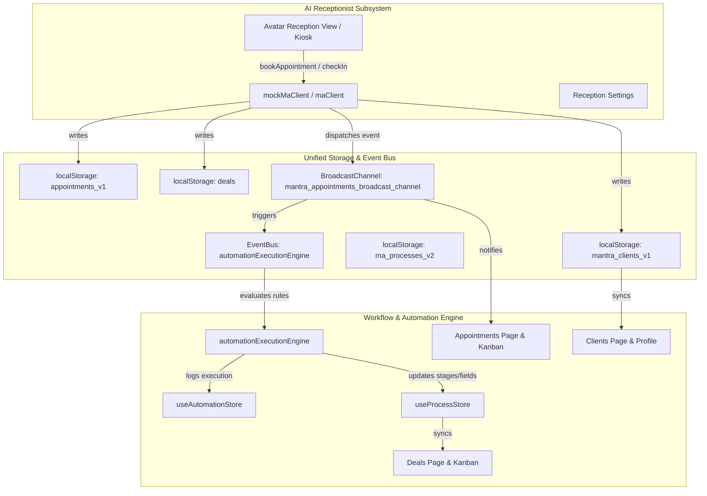

# Merge Integration Architecture: AI Receptionist & Entity Automation Workflows

> **Audience**: AI Coding Agents, Engineers, and System Architects  
> **Repository**: `https://github.com/mantracare-product/ma-figma.git`  
> **Merged Branch**: `customizations` into `ai-receptionist` (Merged at commit `6300b3c`)  
> **Status**: Verified, TypeScript error-free (`npx tsc --noEmit` = 0 errors), Production build passing (`npm run build` = 3,685 modules bundled).

---

## 1. Executive Summary & Purpose

This document provides complete system context regarding the integration of two major architectural initiatives within the **MantraAssist** ecosystem:

1. **AI Receptionist Subsystem** (`ai-receptionist` branch):
   - Interactive Avatar Reception kiosk interface (`AvatarReceptionView`).
   - Voice agent / WebSocket / WebRTC integration with STT, LLM reasoning, TTS, and video speech synchronization.
   - Patient intake, token queue numbering (e.g. `D-001`), consultation room routing, doctor assignment, live check-ins, and mock API client (`mockMaClient.ts` / `maClient.ts`).
   - Reception-specific settings (`ReceptionSettingsTab`) and configuration drawer (`MyAIReceptionist.tsx`).

2. **Entity Workflows & Global Automation Engine** (`customizations` branch):
   - Universal Entity Support across 5 system domains: `client`, `appointment`, `invoice`, `insurance`, and `claim`.
   - Single "Won" stage constraint across both Admin and Client pipelines (strictly 1 Won stage per process, with dynamic system category tagging).
   - Node-based Automation Canvas (`FlowBuilderDrawer`, `automationExecutionEngine`, `automationTree`).
   - Stage automation configuration (`StageAutomationsTab`, `StageAutomationCards`, trigger/action dispatch).
   - Scoped Field Registry (`FieldRegistryContext`, `AdminCustomFields`, dynamic form rendering).
   - Document generation engine with DOCX and PDF template support (`docxProcessor.ts`, `GenerateDocumentDrawer.tsx`).
   - Unified UI navigation (`PageTopBar`, `TableComponent`, `ChevronStageRibbon`).

This guide outlines **how these two domains interface**, **what state is shared**, **how data synchronizes**, and **how edge cases are handled**.

---

## 2. Integrated Data Architecture & Storage Schema

Both subsystems share a reactive client-side database layer that synchronizes between `localStorage`, `sessionStorage`, `BroadcastChannel`, and React state hooks:



### Key Shared Storage Keys

| Storage Key | Primary Store File | Description | Consumed By |
|---|---|---|---|
| `appointments_v1` | `src/lib/appointmentService.ts` | Complete list of appointments. Contains both reception attributes (`source`, `tokenNumber`, `roomName`, `checkedInAt`) and workflow attributes (`currentStageId`, `processName`, `status`). | Appointments Page, Calendar, AI Receptionist, Automation Engine |
| `mantra_clients_v1` / `clients` | `src/lib/clientsStore.ts` | Canonical client database containing personal info, contact data, assigned doctor (`responsible`), and process lists. | Clients Page, ClientProfile, Deal Drawers, Reception Kiosk |
| `ma_processes_v2` | `src/lib/useProcessStore.ts` | Process definitions for `client`, `appointment`, `invoice`, `claim`, and `insurance`. Contains stage sequences, system categories, and reception flags. | Admin Process Templates, Automation Drawer, Kanban Boards |
| `ma_automations_v1` | `src/lib/useAutomationStore.ts` | Active automations, step trees, triggers, and execution history logs. | Automation Builder, Automation Engine, Stage Drawers |
| `deals` | `src/app/pages/Deals.tsx` | Pipeline deals synchronized whenever a process stage changes or an appointment is booked. | Deals Pipeline, Process Detail Drawer |
| `reception_appointments` | `src/reception/lib/api/mockMaClient.ts` | Reception-internal queue containing room routing, token IDs, and avatar status. | AvatarReceptionView, Kiosk Display |

---

## 3. What Happens During Booking & Check-In: End-to-End Walkthrough

### Scenario A: Booking from the AI Receptionist (Avatar / Phone Agent)

1. **User Interaction**:
   - The patient speaks with the AI Receptionist (Avatar kiosk or voice agent).
   - The avatar gathers the patient's name, phone, chosen doctor, date, and time.
2. **Execution via `maClient.bookAppointment` (`src/reception/lib/api/mockMaClient.ts`)**:
   - **Client Creation / Update**: `addOrUpdateClient()` writes patient records to `mantra_clients_v1` with `responsible: doctorName` and assigns the default process (`Appointment Flow` or `Appointment Scheduling`).
   - **Deal Pipeline Synchronization**: `syncDealRecord()` creates or updates a deal card in the active pipeline at the `Confirmed` stage.
   - **Call & Process Logging**: `addProcessCallLog()` records the booking in the audit log.
   - **Appointment Generation**:
     ```ts
     const newApt = {
       id: Date.now(),
       clientName,
       clientPhone,
       clientEmail,
       employeeId: prov.id,
       serviceId: srv.id,
       date,
       time,
       status: 'scheduled',
       source: 'ai_receptionist',         // Identifies booking origin
       tokenNumber: 'D-001',              // Queue token
       roomName: "Dr. Sarah's Consultation Room",
       processId: defaultProcessId,
       stageId: 'Confirmed',              // Initial workflow stage
     };
     ```
   - **Broadcasting**: Sends events to `window` and `BroadcastChannel('mantra_appointments_broadcast_channel')`.
3. **What if NO Automation is Configured yet?**:
   - The appointment **is successfully booked and saved**.
   - It appears immediately on the Appointments List and Calendar views with the `AI Receptionist` badge and token.
   - **No background automation fires**: No automated SMS/WhatsApp reminders or automatic invoice drafts are generated since no triggers match.
   - The admin UI displays an informative lock banner preventing *manual* booking clicks from within the dashboard until an automation is published, but AI Receptionist entries remain safe and intact.
4. **What if Automation IS Configured?**:
   - The `automationExecutionEngine` intercepts the `appointment.created` or `stage.entered` event.
   - Step actions run in order:
     - `send_message`: Sends confirmation WhatsApp/SMS with `tokenNumber` and `roomName`.
     - `create_invoice`: Automatically drafts an invoice for the service amount in `DEFAULT_ENTITY_PROCESSES.invoice`.
     - `update_field`: Automatically flags client VIP or insurance status.

---

### Scenario B: Patient Arrival & Live Check-In at the Kiosk

1. Patient approaches the kiosk and confirms phone number or scan.
2. The AI Receptionist calls `maClient.checkInAppointment(appointmentId)`.
3. The appointment record is updated with:
   - `status: 'checked_in'`
   - `checkedInAt: new Date().toISOString()`
4. If the Appointment Process has a `Checked In` stage:
   - The stage changes to `appt-4` (`Checked In`).
   - If an automation trigger exists for `stage.entered == "Checked In"`:
     - Doctor gets an instant notification.
     - Token display updates on the kiosk screen.
     - Doctor's queue reflects the patient is waiting.

---

## 4. Conflict Resolutions & Code Integrations Summary

During the merge of `customizations` into `ai-receptionist`, 13 files had merge conflicts. Below is how each conflict was resolved:

| File | Nature of Conflict | Resolution Strategy |
|---|---|---|
| `src/lib/useProcessStore.ts` | Conflict between reception settings (`receptionStationId`, `receptionAutoAdvance`) and workflow entity processes + strict single Won stage logic. | **Retained both**: Combined the reception station properties into process definitions while enforcing strict single Won stage validation (`validateSingleWonStage`). |
| `src/app/routes.tsx` | Route definitions for `/reception/avatar` clashed with admin automation and template routes. | **Retained both**: Kept `AvatarReceptionView` routes and all admin workflow routes (`AdminAutomations`, `AdminDocumentTemplates`, etc.). |
| `src/app/pages/Appointments.tsx` | `HEAD` had legacy ~700-line inline calendar vs `customizations` modular `PageTopBar` + `<AppointmentCalendarView />` + automation lock banner. | **Retained `customizations` modern layout**: Extracted modular calendar view, retained availability tab and automation banner, and wired reception attributes. |
| `src/app/components/appointments/AppointmentCard.tsx` | Card display had reception tags (`tokenNumber`, `roomName`, `source`) vs workflow stage select dropdown. | **Retained both**: Card displays token badge, doctor room, and source badge, plus stage progression dropdown in card footer. |
| `src/app/components/fields/FieldInputRenderer.tsx` | Scoped field registry dynamic filtering clashed with basic option synchronizers. | **Retained both**: Kept label cleanup, dynamic driving field filtering, and custom option sync. |
| `src/lib/processLogsStore.ts` | LocalStorage/sessionStorage fallback vs process name migration routine. | **Retained both**: Stores check both storage mediums and auto-migrate legacy process names. |
| `src/app/pages/CallLogs.tsx` | Telephony call records clashed with `TableComponent` layout. | **Retained both**: Replaced raw tables with `TableComponent` while preserving reactive client bindings and telephony audio players. |
| `src/app/pages/ClientProfile.tsx` | Client reactive store (`useClients`) vs inline target definitions and document drawer. | **Retained both**: Used canonical `useClients` store, properly initialized `isNewClient` and `initialTarget`, and retained DOCX preview capability. |
| `src/app/pages/Clients.tsx` | Hardcoded client array clashed with centralized `clientsStore` and `TableComponent`. | **Retained `clientsStore`**: Used canonical client store while rendering with `TableComponent`. |
| `src/app/pages/Deals.tsx` | Inline mock clients dictionary clashed with storage checks and Chevron stage ribbon. | **Retained dynamic stores**: Cleaned up obsolete inline mock array, retained `localStorage`/`sessionStorage` synchronization, Chevron stage ribbon, and process migration. |
| `src/app/pages/Settings.tsx` | Reception settings tab (`ReceptionSettingsTab`) clashed with organization detail drawer and create modal. | **Retained both**: Kept reception settings tab in the navigation structure and included organization management drawers and modals. |
| `package.json` | Missing dependencies for document rendering (`docx-preview`, `jszip`) from `customizations`. | **Installed both**: Added `docx-preview` and `jszip` to dependencies and verified build. |
| `src/app/pages/Process.tsx` & `AdminProcessTemplates.tsx` | TypeScript type divergence on `Process` interface (`connectedToPatientPortal`, `connectedToAiReceptionist`, `enableCalling`, `enableChatbot`). | **Synchronized interfaces**: Fully synchronized local interfaces with `useProcessStore.ts`, streamlined UI cards with `<InfoTooltip>`, and unified Patient Portal & AI Receptionist activation into a single synchronized toggle. |
| `.gitignore` & `dist/index.html` | Environmental ignore rules and build assets clashed. | **Preserved latest environment rules and fresh production bundle**. |

---

## 5. Process AI Channels, Omnichannel Chatbots & Ecosystem Sync

Processes now support granular AI and channel configuration cards at both the process level and stage level:

1. **Voice AI Calling (`enableCalling`, `callTriggerSettings`)**:
   - Toggles automated outbound/inbound voice AI on the workflow or stage.
1. **Knowledge Base Integration**:
   - Positioned first at the top of the workflow channel configuration for immediate reference.
   - Direct shortcut to create or link reference articles, FAQs, and clinic protocols scoped specifically to the process and its stages.
2. **Voice AI Calling (`enableCalling`, `callTriggerSettings`)**:
   - Toggles automated outbound/inbound voice AI on the workflow or stage.
   - Configured via `CallTriggerDrawer.tsx` (delay, max attempts, retry intervals, time window).
3. **Omnichannel Chatbot (`enableChatbot`, `chatbotSettings`)**:
   - Manages conversational AI across WhatsApp, SMS, and Website live chat widgets.
   - Configured via `ChatbotChannelDrawer.tsx`.
4. **Client Portal & AI Receptionist Activation (`connectedToPatientPortal` & `connectedToAiReceptionist`)**:
   - Single unified toggle activates/deactivates self-booking in Client Portal and real-time call triage in AI Receptionist simultaneously.
   - UI follows clean design standards: no redundant section header clutter, no status capsule badges, and contextual help provided via compact `<InfoTooltip>` components.

---

## 6. Architectural Safeguards for Future AI Agents

When building features on this codebase, any future AI agent or engineer must adhere to the following rules:

1. **Do Not Revert the Single Won Stage Rule**:
   - Every process entity must have **exactly one** stage with `systemCategory: 'won'` (or `completed` for appointments / `paid` for invoices).
   - If an admin toggles a stage to Won, any previously marked Won stage in that process must automatically convert to intermediate.
2. **Preserve Reception Metadata in Appointments**:
   - Whenever appointments are mapped or serialized, ensure `source`, `roomName`, `tokenNumber`, and `checkedInAt` are preserved.
   - Do not assume appointments only originate from the manual web modal.
3. **Keep `Process` Interfaces Synchronized**:
   - The central `Process` interface lives in `src/lib/useProcessStore.ts`.
   - Local declarations in `src/app/pages/Process.tsx` and `src/app/pages/admin/AdminProcessTemplates.tsx` must always include the channel (`enableCalling`, `enableChatbot`) and ecosystem (`connectedToPatientPortal`, `connectedToAiReceptionist`, `receptionEnabled`) fields.
4. **Respect Dual Storage Sync**:
   - All modules sync across both `localStorage` and `sessionStorage` for cross-tab compatibility, iframe embedding, and mock API independence. Always update both when persisting shared entities.
5. **Use Canonical Stores**:
   - Clients: `src/lib/clientsStore.ts`
   - Processes: `src/lib/useProcessStore.ts`
   - Automations: `src/lib/useAutomationStore.ts`
   - Appointments: `src/lib/appointmentService.ts`
   - Field Registry: `src/app/context/FieldRegistryContext.tsx`

