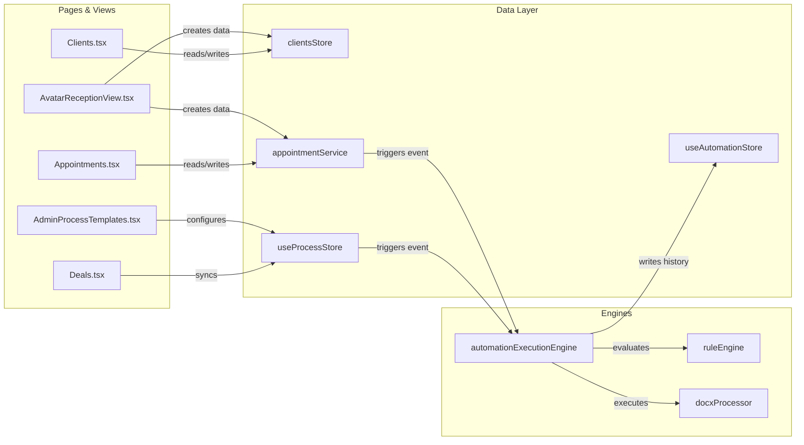

# MantraAssist Project Structure (Post-Merge)

> **Repository**: `https://github.com/mantracare-product/ma-figma.git`  
> **Merged Branch**: `customizations` merged into `ai-receptionist`  
> **Architecture Overview**: Full-stack healthcare CRM, AI Receptionist Kiosk, Voice AI telephony, entity workflow management, and node-based automation execution engine.

---

## 1. Directory Tree Overview

```
e:\mantra-assist\
├── .agents/                          # Customization configurations and agent instructions
├── api/                              # Backend API wrappers and serverless endpoints
├── dist/                             # Vite production build artifacts
├── docs/                             # Architecture specifications and documentation
├── guidelines/                       # UI/UX design guidelines and style system
├── node_modules/                     # Installed npm packages
├── public/                           # Static assets, logos, and sounds
├── server/                           # Backend proxy, WebSocket & media relays
└── src/
    ├── app/                          # Core UI Application (React + Vite)
    │   ├── components/               # UI Component modules
    │   │   ├── activity/             # Audit logs and timeline components
    │   │   ├── appointments/         # Appointment cards, drawers, and calendar
    │   │   ├── auth/                 # Route auth guards and security wrappers
    │   │   ├── automation/           # Automation triggers, nodes, and timeline modals
    │   │   ├── chats/                # Omnichannel chat widgets and simulators
    │   │   ├── common/               # Badges, stage ribbons, icons, tooltips
    │   │   ├── deals/                # Deal pipeline cards and detail drawers
    │   │   ├── fields/               # Scoped dynamic field renderers and pickers
    │   │   ├── help/                 # "How it works" modals and guide tooltips
    │   │   ├── invoices/             # Invoice builder, progress bar, line items
    │   │   ├── layout/               # Admin/Main layouts, Sidebars, TopBars
    │   │   ├── process/              # Workflow stage cards, step catalogs, flow builders
    │   │   ├── profile/              # Client profiles, document generators, tabs
    │   │   ├── reception/            # AI Receptionist settings and station configs
    │   │   ├── reports/              # Custom report builder and visualizers
    │   │   ├── scribe/               # AI Clinical Scribe console drawers
    │   │   ├── settings/             # Roles, orgs, phone numbers, integrations
    │   │   ├── team/                 # Team members, providers, and schedules
    │   │   ├── telephony/            # Call logs, softphone drawer, audio player
    │   │   └── ui/                   # Primitive design system (TableComponent, Modal, Drawer, etc.)
    │   ├── config/                   # Navigation configurations and menu registries
    │   ├── context/                  # React Context providers (Auth, Process, Fields, Invoices)
    │   ├── pages/                    # Main application routes & views
    │   │   ├── admin/                # Admin views (Templates, Fields, Automations, Industries)
    │   │   └── auth/                 # Login and authentication views
    │   ├── types/                    # Core UI TypeScript type definitions
    │   ├── App.tsx                   # Top-level React Router and providers setup
    │   └── routes.tsx                # Centralized application route definitions
    ├── constants/                    # Application constants, country codes, colors
    ├── data/                         # Canonical datasets (canonicalClients.ts, etc.)
    ├── hooks/                        # Custom reusable React hooks
    ├── imports/                      # Static branding assets and images
    ├── lib/                          # State stores, engines, and utilities
    ├── reception/                    # AI Receptionist Avatar kiosk & Voice Engine
    │   ├── avatar/                   # Avatar kiosk interactive UI and speech visualizers
    │   ├── lib/api/                  # Mock client and real API client (mockMaClient, maClient)
    │   └── types/                    # Receptionist domain TypeScript interfaces
    ├── styles/                       # CSS design tokens, animations, and Tailwind imports
    ├── test/                         # Unit tests, integration tests, and vitest suites
    ├── types/                        # Global shared type declarations
    ├── main.tsx                      # Vite React entry point
    └── vite-env.d.ts                 # Vite environment type declarations
```

---

## 2. File-by-File Breakdown

### `src/reception/` (AI Receptionist Subsystem)
* **`avatar/AvatarReceptionView.tsx`**: The full-screen interactive AI Receptionist Kiosk. Features the video avatar, live audio waveforms, speech recognition (STT), conversational LLM responses (TTS), room directions, and quick action cards (Check-In, Walk-In Booking, Talk to Doctor).
* **`lib/api/maClient.ts`**: Contract interface for reception communication (e.g., `bookAppointment`, `checkInAppointment`, `getProviders`, `getServices`).
* **`lib/api/mockMaClient.ts`**: In-browser mock backend client for the Receptionist. Handles appointment booking, token generation (`D-001`), client creation via `addOrUpdateClient()`, pipeline deal synchronization, and room routing.
* **`lib/whisperRecorder.ts`**: In-browser audio recording and voice activity detection (VAD) module for streaming audio to speech engines.
* **`types/reception.ts`**: TypeScript types for reception tokens, stations, avatar moods, and check-in payloads.

---

### `src/app/pages/` (Main Views & Pages)
* **`Appointments.tsx`**: Comprehensive appointment management interface. Supports List, Calendar (Day/Week/Month/Year via `AppointmentCalendarView`), and Team Availability modes. Features filtering by provider, process, and stage, plus the automation lock banner.
* **`Automation.tsx`**: Standalone client view for inspecting and editing entity automation flows.
* **`Clients.tsx`**: Canonical client directory using `TableComponent`. Offers advanced filtering, stage tags, and direct links to client profiles.
* **`ClientProfile.tsx`**: Detailed 360° client profile. Hosts Overview, Documents, Invoices, Appointments, History, and Activity tabs. Integrated with `GenerateDocumentDrawer`.
* **`Deals.tsx`**: Multi-stage Kanban pipeline for sales and process conversions with Chevron stage ribbon and drag-and-drop cards.
* **`Invoices.tsx`**: Billing and invoice management ledger with stage lifecycle (Draft -> Sent -> Paid / Overdue).
* **`MyAIReceptionist.tsx`**: Admin control center for AI Receptionist configuration: voice tone, persona, operating hours, reception stations, and test previews.
* **`AIScribeConsole.tsx`**: Ambient clinical scribe console for recording doctor-patient visits, extracting clinical notes, SOAP notes, and coding CPT/ICD codes.
* **`CallLogs.tsx`**: Telephony records table showing Inbound/Outbound calls, durations, transcripts, recordings, and linked process stages.
* **`Chats.tsx`**: Omnichannel live chat workspace covering WhatsApp, SMS, Web Chat, and AI Chatbot conversations.
* **`Claims.tsx`**: Health insurance claims submission and tracking board.
* **`Overview.tsx`**: Executive metrics dashboard with KPI summaries, visit trends, and pending tasks.
* **`Payments.tsx`**: Payment gateway settlements and transaction logs.
* **`Process.tsx`**: Client-side process editor and viewer showing stages, automation rules, AI voice calling toggles, omnichannel chatbot channel settings, Knowledge Base linking, and unified Client Portal & AI Receptionist activation.
* **`Reports.tsx`**: Custom report generator allowing ad-hoc querying across clients, appointments, and deals.
* **`Services.tsx`**: Clinic service catalog (pricing, duration, associated department).
* **`Settings.tsx`**: Master configuration hub (Team, Roles, Organizations, Integrations, Telephony, and `ReceptionSettingsTab`).
* **`UserManagement.tsx`**: User roles, access permissions, and staff directory.
* **`WebForms.tsx`**: Online patient intake form builder and submission tracker.

---

### `src/app/pages/admin/` (System Administration)
* **`AdminAutomations.tsx`**: Global admin automation management for creating cross-entity rule chains.
* **`AdminCustomFields.tsx`**: Custom field schema builder allowing scoped field additions across all 5 entities.
* **`AdminDocumentTemplates.tsx`**: Template repository for DOCX/PDF contracts, consent forms, and receipts with dynamic merge tag variables.
* **`AdminIndustries.tsx`**: Preset industry packs (Healthcare, Dental, Physio, Legal) that configure initial processes.
* **`AdminProcessTemplates.tsx`**: Process designer for building stage workflows, enforcing the strict single Won stage rule, attaching automation triggers, configuring AI calling/chatbot channels, and managing ecosystem synchronization.

---

### `src/app/components/` (Key Reusable Component Groups)
* **`appointments/`**:
  * `AppointmentCard.tsx`: Rich card rendering appointment time, provider, client, stage selector, and reception tokens.
  * `AppointmentCalendarView.tsx`: Modern month/week/day calendar grid with click-to-book and appointment detail drawers.
  * `ScheduleAppointmentDrawer.tsx`: 4-step guided booking drawer with slot availability computation.
  * `TeamAvailabilityTab.tsx`: Schedule grid displaying provider working hours, breaks, and days off.
* **`process/`**:
  * `CallTriggerDrawer.tsx`: Drawer for configuring automated voice AI call triggers (delays, retry limits, intervals, operating hours).
  * `ChatbotChannelDrawer.tsx`: Drawer for configuring omnichannel conversational AI across WhatsApp, SMS, and Website live chat widgets.
  * `FlowBuilderDrawer.tsx`: Visual canvas for designing node-based automation graphs (Trigger -> Condition -> Action).
  * `StageAutomationsTab.tsx`: Tab inside process editors displaying stage-specific triggers and actions.
  * `StageAutomationCards.tsx`: Clean UI cards representing individual automation rules attached to a stage.
  * `StepCatalogDrawer.tsx`: Catalog drawer of available automation actions (Send WhatsApp, Generate Document, Create Invoice, etc.).
* **`profile/`**:
  * `GenerateDocumentDrawer.tsx`: High-fidelity document generator rendering live DOCX previews via `docx-preview` and generating PDFs.
  * `DocumentsTab.tsx`: Document repository attached to a client profile.
  * `DraggableOverviewSections.tsx`: Drag-and-drop section layout for custom fields on client profiles.
* **`ui/`**:
  * `TableComponent.tsx`: High-performance data table component with sorting, pagination, custom actions, and bulk operations.
  * `DrawerShell.tsx`: Standardized slide-over drawer container.
  * `Modal.tsx`: Accessible dialog container.
* **`common/`**:
  * `ChevronStageRibbon.tsx`: Visual Chevron progression bar for process stages with custom palette colors (`CHEVRON_PALETTE`).

---

### `src/lib/` (Core Logic, Engines, and State Stores)
* **`appointmentService.ts`**: Canonical appointment data service handling storage, CRUD, and status migrations.
* **`useProcessStore.ts`**: Master process store managing processes across all 5 entity types (`client`, `appointment`, `invoice`, `claim`, `insurance`). Enforces the strict single Won stage rule.
* **`useAutomationStore.ts`**: Store for global and stage-specific automation definitions, execution states, and audit trails.
* **`automationExecutionEngine.ts`**: Core workflow execution engine. Listens for entity events (create, update, stage transition) and executes automation steps.
* **`automationTree.ts` & `automationNormalizer.ts`**: Serializers and layout graph builders for the node-based automation tree.
* **`clientsStore.ts`**: Canonical client database store reactive across `localStorage`, `sessionStorage`, and `BroadcastChannel`.
* **`processLogsStore.ts`**: Central event logger for stage changes, call triggers, and automated updates.
* **`docxProcessor.ts`**: Client-side DOCX manipulation engine using `jszip` to replace merge tags (`{{client.name}}`, etc.) directly inside Word files.
* **`ruleEngine.ts`**: Evaluates conditions (e.g. `amount > 500`, `status == 'Confirmed'`) in automation workflows.
* **`activityEngine.ts`**: Audit logger recording staff actions and automated events.
* **`teamStore.ts`**: Team members directory and appointment-booking capability flags (`canBookAppointments`).
* **`invoiceService.ts` & `claimsStore.ts`**: Dedicated stores for billing cycles and insurance claim adjudications.

---

## 3. High-Level Dependency Graph



---

## 4. Summary

Every file in the repository now fits into a coherent pipeline:
1. **Reception layer** (`src/reception/`) handles physical and conversational intake.
2. **Entity layer** (`src/lib/*Store.ts`) standardizes state across clients, appointments, and bills.
3. **Automation layer** (`src/lib/automation*.ts`) listens for changes and executes automated business logic.
4. **Presentation layer** (`src/app/pages/`) delivers responsive, consistent UI across both staff dashboards and patient kiosks.
