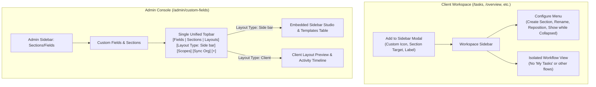

# Sidebar Navigation & Layouts: Comprehensive Implementation Documentation

**Date:** November 23, 2026  
**Status:** Completed & Deployed to `main` (`5965f16`)  
**Scope:** Client Workspace Sidebar, Tasks Workflow Isolation, Admin Console Consolidation, Unified Topbar Architecture.

---

## 1. Executive Summary

Today's work consolidated and modernized the **Sidebar Navigation** system across both client workspaces and the administrative management console:

1. **Client Workspace Customization:** Users can fully organize their workspace sidebar—creating custom sections, reordering and renaming sections and pages, choosing custom Lucide icons, and toggling visibility when collapsed.
2. **Dedicated Workflow Isolation in Tasks:** Workflows pinned from the Tasks topbar (available only on "Tasks by me") render as dedicated workspace pages displaying strictly that workflow's tasks without tabs or other workflows.
3. **Admin Consolidation:** The administrative "Sidebar Navigation" was shifted into **"Sections/Fields"** under a new **"Layouts"** tab, retiring the redundant sidebar menu item.
4. **Single Unified Topbar:** Replaced multi-tiered toolbars and separate floating cards with a single-line, compact topbar containing scope filters, an in-bar entity switcher, and icon-only action buttons.



---

## 2. Client-Side Sidebar Enhancements

### 2.1 Configure Menu & Section Management
In the client sidebar's Configure drawer/menu (`SidebarConfigDrawer.tsx` / `SidebarMenuContext.tsx`):
- **Create New Sections:** Users can add custom sidebar sections using a clean `+` icon button.
- **Rename Sections & Pages:** Direct inline editing or modal renaming for existing and newly created sections and pages.
- **Section Repositioning:** Support for moving sections up or down to customize hierarchy and workflow grouping.
- **"Show while collapsed" Toggle:** Renamed from the legacy "Feature this page" to the clearer, user-centric label **"Show while collapsed"**.

### 2.2 Add to Sidebar Modal with Icon Picker
When an item, workflow, or custom page is pinned or added to the sidebar:
- A dedicated popup prompts the user to select:
  1. **Page Title / Name:** Custom human-readable label.
  2. **Target Section:** Dropdown of available sections (e.g. `WORKSPACE`, `REVENUE & INSIGHTS`, `CUSTOMIZATIONS`, or custom sections).
  3. **Icon Selector:** Grid of popular icons (Stethoscope, FileText, CheckSquare, Zap, Activity, Shield, Users, Tag, Calendar, etc.) with instant live preview.

### 2.3 Tasks Header Gear & Dedicated Workflow Isolation
- **Contextual Gear Icon:** Added the settings gear icon exclusively on the **"Tasks by me"** tab in the Tasks topbar.
- **Workflow Pinning:** Allows adding the selected task workflow directly into the sidebar.
- **Dedicated Workflow Page Isolation:**
  - When accessing a pinned task workflow page from the sidebar (e.g. `/tasks?workflow=process-task-default&pinned=true`), the page is displayed as an isolated view.
  - The tabs `"My Tasks"` and other workflow options are hidden; only the tasks belonging strictly to that selected workflow are presented.

---

## 3. Admin-Side Console Consolidation

### 3.1 Migration to "Custom Fields & Sections" (`/admin/custom-fields`)
The standalone **"Sidebar Navigation"** item (`/admin/sidebar-config`) was removed from the admin sidebar menu (`AdminSidebar.tsx`). It is now unified inside **"Sections/Fields"**:
- **3rd Tab Introduced:** `Fields` | `Sections` | **`Layouts`**.
- **Layout Type Selector:** When set to `Side bar`, the full sidebar configuration engine (`AdminSidebarConfig`) is embedded directly.
- **Feature Parity:** 100% of the templates table, admin scoping rules, category/industry/location filters, duplicate/edit/delete actions, and the visual drag-and-drop studio drawer (`SidebarTemplateDrawer.tsx`) are retained.

### 3.2 Backward Compatibility & URL Redirects
In [routes.tsx](file:///c:/Users/Mantra/.gemini/antigravity/scratch/ma-figma/src/app/routes.tsx), the legacy paths are routed to the consolidated view:
- `/admin/sidebar-config` $\rightarrow$ `/admin/custom-fields?tab=layouts&entity=sidebar`
- `/admin/sidebar` $\rightarrow$ `/admin/custom-fields?tab=layouts&entity=sidebar`
- `/admin/sidebar-templates` $\rightarrow$ `/admin/custom-fields?tab=layouts&entity=sidebar`

---

## 4. Single Unified Top Bar Architecture

To eliminate clutter and visual redundancy, the administration interface was streamlined from two stacked toolbars and an intermediate control card into **one single unified topbar**:

```
+----------------------------------------------------------------------------------------------------------------------------------------------------------+
| [ Fields | Sections | Layouts ]  Layout: [ Side bar v ] | [ Categories v ] [ Industries v ] [ Locations v ] [ Organizations v ]  [ Search templates... ]  (Sync) (+) |
+----------------------------------------------------------------------------------------------------------------------------------------------------------+
```

### 4.1 Key Architecture Points
1. **Left Corner Segmented Navigation:** The segmented pill tabs `[ Fields | Sections | Layouts ]` sit at the far-left corner of the bar.
2. **In-Bar Layout Type:** The `Layout: [ Side bar ▾ ]` selector sits inline right next to the tabs, eliminating the separate middle card.
3. **Compact Admin Scope Filters:**
   - Filters for `Category`, `Industry`, `Location`, and `Target Organization` are embedded inline.
   - Selects have compact heights (`34px`), smaller padding, and explicit truncation (`max-w-[95px]` to `max-w-[115px]`).
4. **Service Option Removed:** The redundant `Service: Automobile` dropdown was completely removed.
5. **Target Org & Sync Org in Scope:**
   - Target Organization is integrated into the admin scope filter (`[ All Organizations ▾ ]`).
   - `Sync Org` is an icon-only button (`<RefreshCw />`) with tooltip.
6. **Icon-Only Add Template Action:** The primary `+ Add Sidebar Template` button is an icon-only capsule (`<Plus />`), matching the circular action buttons across the app.
7. **Single Line Alignment:** Enabled `flex-nowrap shrink-0` across the control cluster, preventing any row wrapping.
8. **Inner Topbar Suppression:** When `AdminSidebarConfig` is rendered with `hideTopBar={true}`, its internal `PageTopBar` is omitted, and search/filters are passed via props while actions are triggered via `forwardRef` (`sidebarConfigRef.current.openCreateDrawer()`).

---

## 5. Affected Files & Changelog

| File | Changes Made |
| :--- | :--- |
| [AdminSidebar.tsx](file:///c:/Users/Mantra/.gemini/antigravity/scratch/ma-figma/src/app/components/layout/AdminSidebar.tsx) | Removed standalone `Sidebar Navigation` navigation item from `TEMPLATES`. |
| [AdminCustomFields.tsx](file:///c:/Users/Mantra/.gemini/antigravity/scratch/ma-figma/src/app/pages/admin/AdminCustomFields.tsx) | Added `Layouts` tab, compact topbar with in-bar layout entity, admin scope filters, icon-only buttons, and embedded `AdminSidebarConfig`. Removed redundant middle card. |
| [AdminSidebarConfig.tsx](file:///c:/Users/Mantra/.gemini/antigravity/scratch/ma-figma/src/app/pages/admin/AdminSidebarConfig.tsx) | Wrapped with `forwardRef`, exposed `AdminSidebarConfigRef`, added `hideTopBar` support, and accepted external scope/search props. |
| [routes.tsx](file:///c:/Users/Mantra/.gemini/antigravity/scratch/ma-figma/src/app/routes.tsx) | Added backward-compatible redirects from legacy `/admin/sidebar-config` and `/admin/sidebar` routes. |
| [SidebarMenuContext.tsx](file:///c:/Users/Mantra/.gemini/antigravity/scratch/ma-figma/src/app/context/SidebarMenuContext.tsx) | Supported section renaming, repositioning, creation with `+` icon, icon picker, and isolated workflow matching. |
| [Tasks.tsx](file:///c:/Users/Mantra/.gemini/antigravity/scratch/ma-figma/src/app/pages/Tasks.tsx) | Added settings gear icon only on "Tasks by me", workflow pin modal, and isolated workflow view mode. |

---

## 6. Verification & Build Confirmation

- **Vite Production Build:** Verified with `npm run build` (`✓ built in 21.27s`, 0 errors).
- **Git Status:** Clean, pushed to `origin/main` (latest commits `2f66734`, `52d0459`, and `5965f16`).
