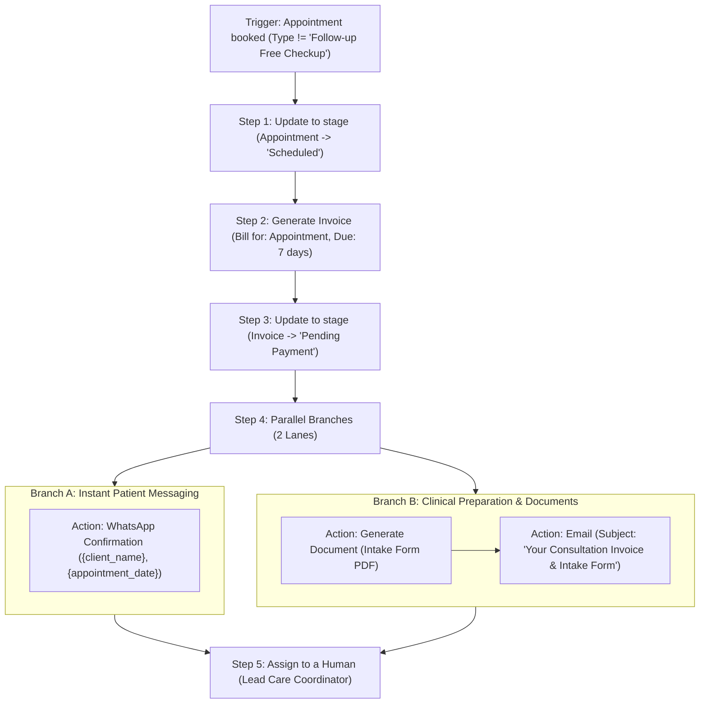
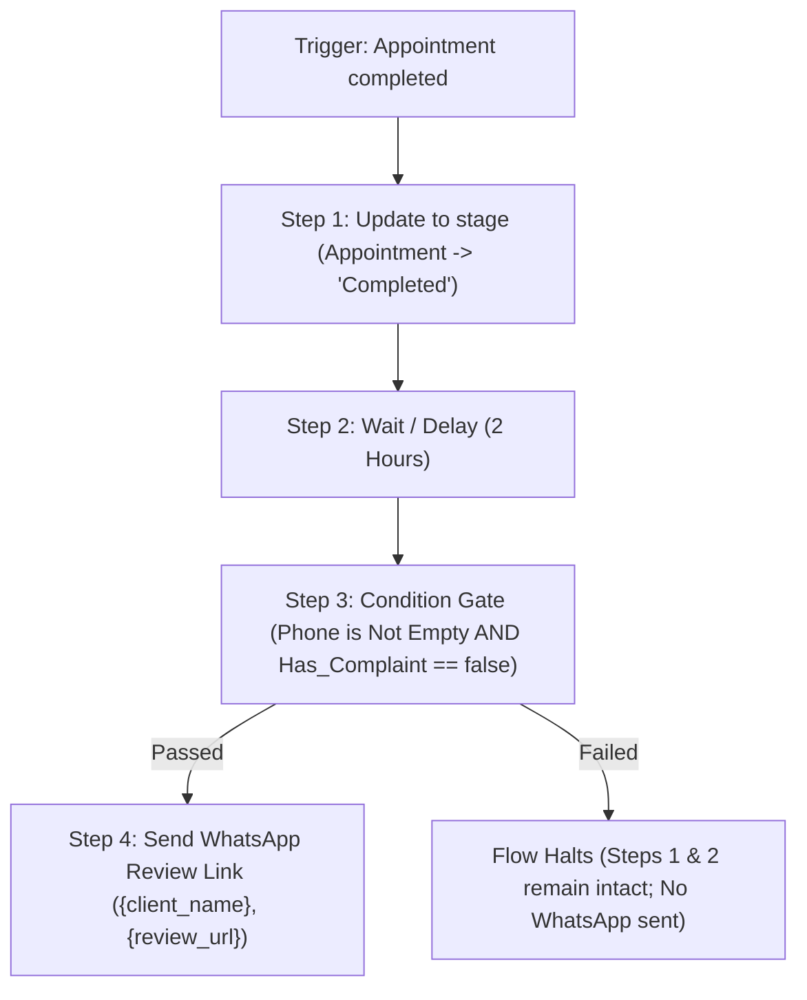

# MantraAssist Automation Module — Sample Use Cases

**Document Type:** Practical Implementation & Verification Scenarios  
**Reference Document:** Automation Module Product Requirements Document (PRD)  
**Entities Covered:** Client, Appointment, Invoice  
**Scope:** Stage Scope & Global Scope Automations  

---

## Use Case 1: Automated Post-Booking Invoicing & Multi-Channel Patient Onboarding

### 1. Business Context & Objective
When a patient books an initial consultation appointment through the front desk or web portal, the clinic needs to:
1. Move the appointment record into the `"Scheduled / Confirmed"` stage.
2. Automatically generate an itemized invoice for the consultation fee.
3. Automatically move that newly generated invoice into `"Draft / Pending Payment"`.
4. Run parallel communications: send an immediate WhatsApp booking confirmation with the appointment details and send a formal email containing the intake document and invoice link.
5. Reassign or set the responsible care team coordinator.

---

### 2. PRD Features Exercised
- **FR-15 & FR-16:** Global scope automation triggered by an appointment event (`Appointment booked`).
- **FR-21 & FR-24:** Trigger Conditions filtering only high-value or specific consultation appointment types.
- **FR-28 & FR-21:** Action output passing (`Generate Invoice` passing `invoice_id` to subsequent steps).
- **FR-29 & FR-30:** `Update to stage` moving the appointment and invoice within their respective entity boundaries.
- **FR-33 & FR-34:** Parallel branch execution splitting WhatsApp SMS and email dispatch.
- **FR-27:** Dynamic variable resolution (`{client_name}`, `{appointment_date}`, `{invoice_id}`).

---

### 3. Step-by-Step Configuration in UI

#### A. Rule Metadata & Trigger Setup (Drawer)
1. **Navigation:** Navigate to **Automations** (`/automations`) -> Click **+ Create Rule**.
2. **Rule Name:** `New Appointment Booking: Auto-Invoice & Onboarding`.
3. **Description:** `Generates draft invoice, moves appointment stage, and dispatches parallel WhatsApp + Email upon appointment booking.`
4. **Trigger Category:** Select `Appointment`.
5. **Trigger Event:** Select `Appointment booked`.
6. **Trigger Conditions (Filter):**
   - Click **+ Add Blank** under Trigger Conditions.
   - **Primary Field:** `appointment_type` (Select from Registry).
   - **Operator:** `!=` (Not Equal).
   - **Value Type:** `Static Value`.
   - **Value:** `Follow-up Free Checkup`.

---

#### B. Step Sequence Configuration (Flow / Canvas)



##### Step 1: Update Appointment Stage
- **Action:** `Update to stage`
- **Entity:** `Appointment`
- **Process / Pipeline:** `Appointment Flow` (Default)
- **Target Stage:** `Scheduled`
- **End Current Process:** `Disabled`

##### Step 2: Generate Invoice
- **Action:** `Generate Invoice`
- **Bill For:** `Appointment`
- **Quantity:** `1`
- **Discount:** `0%`
- **Due In:** `7 days`
- **Payment Mode:** `Online / UPI / Card`
- *Runtime Output:* Yields `new_invoice_id` and `invoice_total`.

##### Step 3: Update Invoice Stage
- **Action:** `Update to stage`
- **Entity:** `Invoice`
- **Process / Pipeline:** `Billing & Invoicing`
- **Target Stage:** `Pending Payment`
- *Entity Boundary Check:* Passed (Invoice action updating Invoice pipeline).

##### Step 4: Parallel Branches (Split into 2 Lanes)
- **Node Type:** `Parallel Branches`
- **Branch Count:** `2`

* **Branch A (Instant Patient Messaging):**
  - **Step 4.A.1 (WhatsApp):**
    - **Account:** Connected clinic WhatsApp business number.
    - **Template:** `appointment_confirmation_v2`
    - **Variables Mapped:**
      - Patient Name: `{client_name}`
      - Date & Time: `{appointment_date} at {appointment_time}`
      - Provider: `{doctor_name}`

* **Branch B (Clinical Documents & Billing Email):**
  - **Step 4.B.1 (Generate Document):**
    - **Select Entity:** `Appointment`
    - **Select Template:** `Patient Intake & Consent Form`
    - **File Name:** `Intake_{client_name}_{appointment_id}`
    - **Output Format:** `PDF`
  - **Step 4.B.2 (Email):**
    - **Recipient:** `{client_email}`
    - **Subject:** `Appointment Confirmed & Invoice #{invoice_id} Details`
    - **Body:** `Dear {client_name}, your consultation is confirmed for {appointment_date}. Attached is your intake form. Your invoice #{invoice_id} of {invoice_amount} has been generated.`

##### Step 5: Assign Care Team Coordinator
- **Action:** `Assign to a Human`
- **Assign To:** `Sarah Jenkins (Care Operations)`

---

### 4. Real Stored Data Shape (`JSON`)

```json
{
  "id": "rule-appt-booked-onboarding-001",
  "name": "New Appointment Booking: Auto-Invoice & Onboarding",
  "description": "Generates draft invoice, moves appointment stage, and dispatches parallel WhatsApp + Email upon appointment booking.",
  "scope": "global",
  "enabled": true,
  "category": "Appointment",
  "trigger": {
    "event": "appointment.booked",
    "entity": "Appointment",
    "conditions": [
      {
        "id": "tc-1",
        "field": "appointment_type",
        "operator": "!=",
        "valueType": "static",
        "value": "Follow-up Free Checkup"
      }
    ]
  },
  "steps": [
    {
      "id": "step-1",
      "type": "action",
      "action": "update_to_stage",
      "label": "Move Appointment to Scheduled",
      "parameters": {
        "entity": "Appointment",
        "processId": "process-appointment-default",
        "stageId": "stage-appt-scheduled",
        "stageName": "Scheduled",
        "endCurrentProcess": false
      }
    },
    {
      "id": "step-2",
      "type": "action",
      "action": "action_generate_invoice",
      "label": "Generate Consultation Invoice",
      "parameters": {
        "billFor": "Appointment",
        "quantity": 1,
        "discount": 0,
        "dueDays": 7,
        "paymentMode": "Card / Online"
      }
    },
    {
      "id": "step-3",
      "type": "action",
      "action": "update_to_stage",
      "label": "Move Invoice to Pending Payment",
      "parameters": {
        "entity": "Invoice",
        "processId": "process-invoice-default",
        "stageId": "stage-inv-pending-payment",
        "stageName": "Pending Payment",
        "endCurrentProcess": false
      }
    },
    {
      "id": "step-4",
      "type": "parallel",
      "label": "Parallel Messaging & Intake Docs",
      "branches": [
        {
          "id": "branch-1",
          "name": "WhatsApp Branch",
          "steps": [
            {
              "id": "step-4-1",
              "type": "action",
              "action": "action_send_whatsapp",
              "label": "Send WhatsApp Confirmation",
              "parameters": {
                "templateId": "tmpl-appt-confirm-01",
                "phone": "{client_phone}",
                "variables": {
                  "patient_name": "{client_name}",
                  "date": "{appointment_date}",
                  "time": "{appointment_time}"
                }
              }
            }
          ]
        },
        {
          "id": "branch-2",
          "name": "Document & Email Branch",
          "steps": [
            {
              "id": "step-4-2",
              "type": "action",
              "action": "action_generate_document",
              "label": "Generate Intake PDF",
              "parameters": {
                "entity": "Appointment",
                "templateId": "doc-tmpl-intake-form",
                "fileName": "Intake_{client_name}_{appointment_id}",
                "outputFormat": "pdf"
              }
            },
            {
              "id": "step-4-3",
              "type": "action",
              "action": "action_send_email",
              "label": "Send Invoice & Welcome Email",
              "parameters": {
                "recipient": "{client_email}",
                "subject": "Appointment Confirmed & Invoice #{invoice_id} Details",
                "body": "Dear {client_name}, your consultation is confirmed for {appointment_date}. Attached is your intake form. Your invoice #{invoice_id} of {invoice_amount} has been generated."
              }
            }
          ]
        }
      ]
    },
    {
      "id": "step-5",
      "type": "action",
      "action": "action_assign_human",
      "label": "Assign Care Coordinator",
      "parameters": {
        "assigneeId": "user-sarah-jenkins",
        "assigneeName": "Sarah Jenkins"
      }
    }
  ],
  "createdAt": "2026-10-14T15:30:00Z",
  "updatedAt": "2026-10-14T15:30:00Z"
}
```

---

### 5. Expected Runtime Execution & Acceptance Verification

| Sequence | Event / Node | Input Context | Executed Behaviour | Resulting State / Log | Acceptance Check |
| :--- | :--- | :--- | :--- | :--- | :--- |
| **0** | Receptionist books appointment `APT-1044` for patient `CL-0082` | `appointment_type: "Full Diagnostic"` | Event `appointment.booked` emitted on EventBus. | Rule `rule-appt-booked-onboarding-001` matches trigger. | **AC-13, AC-14** |
| **1** | **Trigger Condition Evaluation** | `appointment_type` is `"Full Diagnostic"` | `"Full Diagnostic" != "Follow-up Free Checkup"` evaluated as **TRUE**. | Automation execution proceeds to Step 1. | **AC-15, AC-16** |
| **2** | **Step 1: Update to stage** | Record: `APT-1044` | Evaluates target pipeline: `process-appointment-default`. Matches entity boundary (`Appointment`). | Appointment `APT-1044` stage ribbon updates to **Scheduled**. Written to Movement Log. | **AC-4, AC-22, AC-23** |
| **3** | **Step 2: Generate Invoice** | Record: `APT-1044` | Invoicing engine creates new invoice for patient `CL-0082`. | Invoice `INV-CL-1092` created with total `$150.00`. `invoice_id` stored in execution context. | **AC-21** |
| **4** | **Step 3: Update to stage** | Record: `INV-CL-1092` | Evaluates target pipeline: `process-invoice-default`. Matches entity boundary (`Invoice`). | Invoice `INV-CL-1092` moves to **Pending Payment** stage ribbon. | **AC-4, AC-23** |
| **5** | **Step 4: Parallel Branches** | Branch 1 & Branch 2 | Dispatches WhatsApp and Email concurrently. | Both branches execute successfully without blocking each other. | **AC-26** |
| **6** | **Step 5: Assign to a Human** | Coordinator: Sarah Jenkins | Updates responsible user field on client `CL-0082`. | Assigned to Sarah Jenkins. Activity log written. | **AC-32** |

---

## Use Case 2: Post-Consultation Follow-Up with Mid-Flow Condition Gate & Delayed Review Request

### 1. Business Context & Objective
When an appointment is marked as `Completed`:
1. Move the appointment stage to `"Completed"`.
2. Wait for 2 hours (cooling-off period).
3. Check a **Condition Gate**: verify that the client has a registered phone number and has no active complaints recorded in custom fields.
4. If conditions pass, trigger a WhatsApp satisfaction review request. If conditions fail, halt further messages and alert the clinic manager.

---

### 2. PRD Features Exercised
- **FR-20 & FR-22:** Mid-flow **Condition Gate** component (acting as an execution filter after previous steps have run).
- **FR-25:** Condition field handling, dynamic checks, and empty/missing field safety.
- **FR-32:** `Wait / Delay` flow node with configurable time units.
- **AC-17 & AC-25:** Sequential persistence across time delays and stoppage on condition gate failure.

---

### 3. Step Sequence Configuration



##### Flow Nodes:
1. **Trigger:** `Appointment completed` (Category: `Appointment`).
2. **Step 1:** `Update to stage` -> Target: `Appointment Flow` -> Stage: `Completed`.
3. **Step 2:** `Wait / Delay` -> Duration: `2`, Unit: `hours`.
4. **Step 3:** `Condition Gate`:
   - Condition 1: `client_phone` `!=` `empty`
   - Condition 2: `has_active_complaint` `==` `false` (Boolean Custom Field)
5. **Step 4:** `WhatsApp` -> Template: `post_visit_review_survey` -> Params: `{client_name}`, `{review_link}`.

---

### 4. Stored Data Shape (`JSON`)

```json
{
  "id": "rule-appt-completed-delayed-review",
  "name": "Post-Consultation Delayed Review Flow",
  "scope": "global",
  "enabled": true,
  "category": "Appointment",
  "trigger": {
    "event": "appointment.completed",
    "entity": "Appointment"
  },
  "steps": [
    {
      "id": "step-1",
      "type": "action",
      "action": "update_to_stage",
      "label": "Mark Appointment Stage Completed",
      "parameters": {
        "entity": "Appointment",
        "processId": "process-appointment-default",
        "stageId": "stage-appt-completed",
        "stageName": "Completed"
      }
    },
    {
      "id": "step-2",
      "type": "delay",
      "label": "Wait 2 Hours After Consultation",
      "parameters": {
        "duration": 2,
        "unit": "hours"
      }
    },
    {
      "id": "step-3",
      "type": "condition_gate",
      "label": "Verify Client Contact & Feedback Eligibility",
      "rules": [
        {
          "id": "rule-cg-1",
          "field": "client_phone",
          "operator": "not_empty",
          "valueType": "static",
          "value": ""
        },
        {
          "id": "rule-cg-2",
          "field": "has_active_complaint",
          "operator": "==",
          "valueType": "static",
          "value": "false"
        }
      ]
    },
    {
      "id": "step-4",
      "type": "action",
      "action": "action_send_whatsapp",
      "label": "Send Google Review Request",
      "parameters": {
        "templateId": "tmpl-google-review-invite",
        "phone": "{client_phone}",
        "variables": {
          "patient_name": "{client_name}",
          "review_url": "https://g.page/r/mantracare/review"
        }
      }
    }
  ]
}
```

---

## Use Case 3: Stage-Scope On-Entry Automation (Intake Stage Welcome Packet)

### 1. Business Context & Objective
In the Client Workflow (`"Patient Care Journey"`), whenever a client enters the stage `"Initial Intake"`, an internal stage automation automatically logs a webhook ping to the EHR system and updates a custom client field `"intake_initiated_at"` with the current timestamp.

---

### 2. PRD Features Exercised
- **FR-14 & AC-11:** Stage scope drawer: trigger locked to current stage on-entry (`stage.entered`), with `Update to stage` forbidden/hidden from the action menu.
- **FR-27:** `Field Update` modifying custom client fields.
- **Appendix A:** `Webhook Automation` executing outbound GET request.

---

### 3. Step Sequence Configuration
- **Drawer Scope:** Stage Scope (Opened directly from `"Initial Intake"` stage header in Workflow Builder).
- **Trigger:** Locked to `On Stage Enter` for stage `"Initial Intake"`.
- **Step 1:** `Field Update` -> Field: `intake_initiated_at` -> Value: `{current_timestamp}`.
- **Step 2:** `Webhook Automation` -> URL: `https://api.internal-clinic-ehr.com/v1/patient-intake?clientId={client_id}`.

---

### 4. Stored Data Shape (`JSON`)

```json
{
  "id": "stage-rule-intake-entry-001",
  "name": "Intake Stage Entry Webhook & Timestamp",
  "scope": "stage",
  "stageId": "stage-client-initial-intake",
  "processId": "proc-patient-care-journey",
  "enabled": true,
  "trigger": {
    "event": "stage.entered",
    "stageId": "stage-client-initial-intake",
    "stageName": "Initial Intake"
  },
  "steps": [
    {
      "id": "step-1",
      "type": "action",
      "action": "action_update_field",
      "label": "Set Intake Initiated Timestamp",
      "parameters": {
        "field": "intake_initiated_at",
        "valueSource": "variable",
        "value": "{timestamp}"
      }
    },
    {
      "id": "step-2",
      "type": "action",
      "action": "action_external_webhook",
      "label": "Notify Clinic EHR",
      "parameters": {
        "name": "EHR Intake Sync",
        "targetUrl": "https://api.internal-clinic-ehr.com/v1/patient-intake?clientId={client_id}",
        "method": "GET"
      }
    }
  ]
}
```
